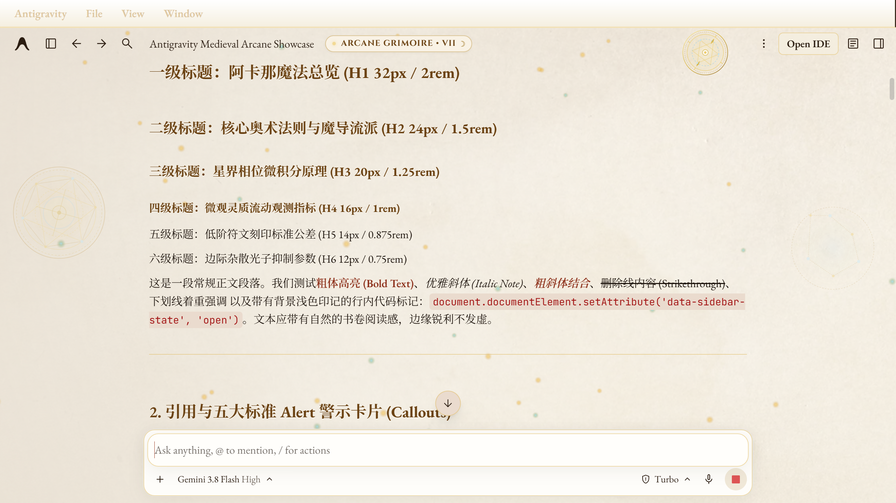
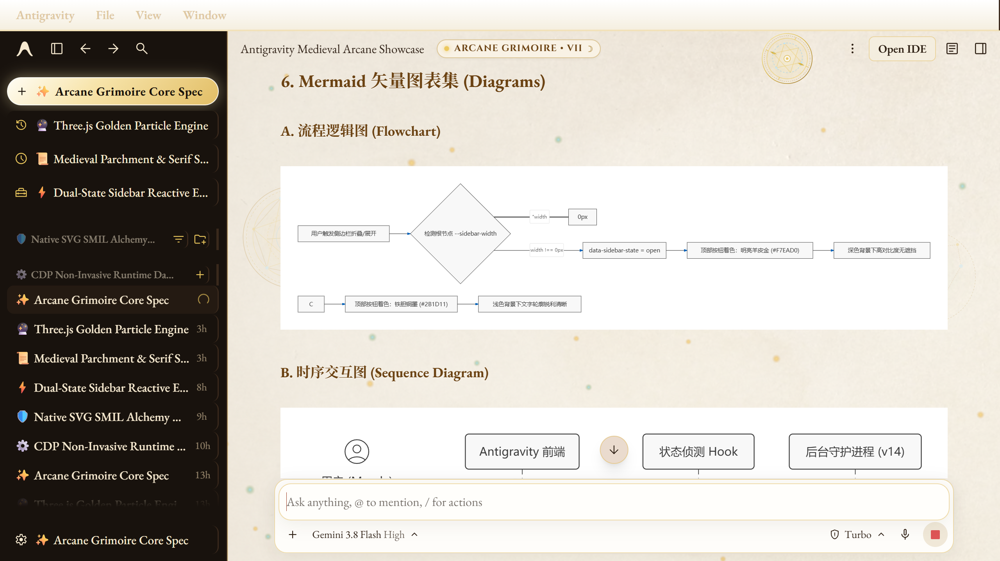
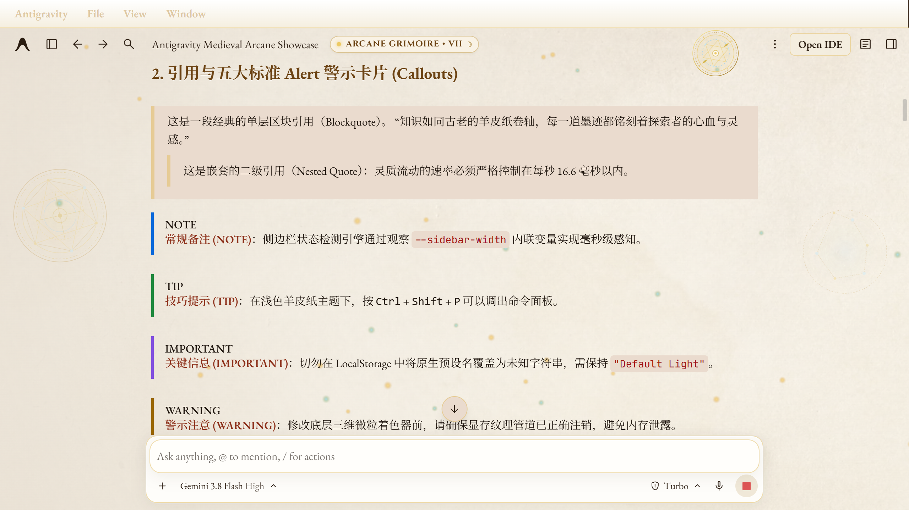
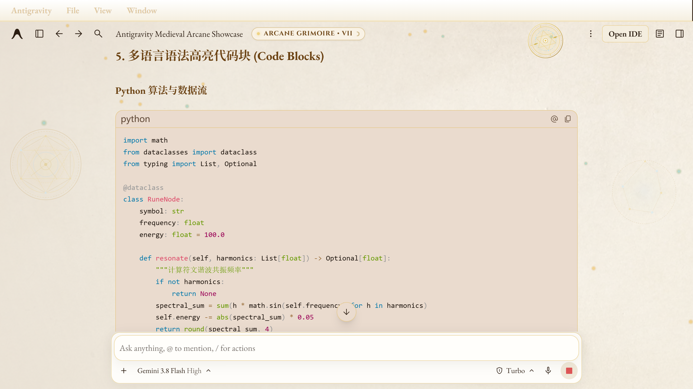
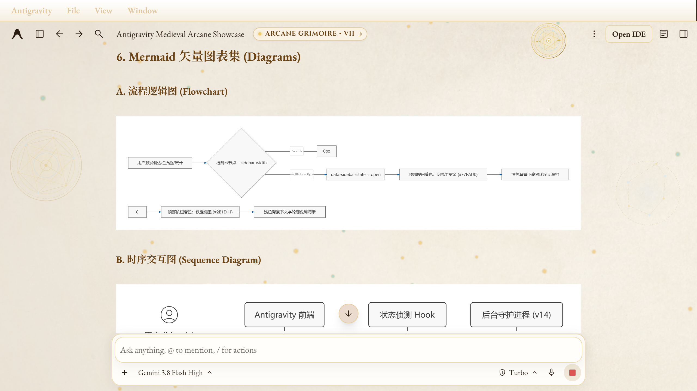

# Antigravity Medieval Arcane

<p align="center">
  
</p>

<p align="center">
  <a href="https://github.com/MandyRalyeh/antigravity-medieval-arcane/releases"></a>
  <a href="LICENSE"></a>
  
  
  
</p>

<p align="center">
  <b>English</b> · <a href="README.zh-CN.md">简体中文</a>
</p>

> **An immersive Medieval Arcane Grimoire fantasy theme and UI runtime enhancement engine for Google Antigravity.**  
> *Non-invasive runtime hot-injection via Chrome DevTools Protocol · Zero binary patching · Zero .asar rebuilding · Preserves client auto-updates · 100% reversible with one click.*

---

## What Is This?

This is a personal interface patch and immersive Medieval Arcane theme I developed while pair-programming with Antigravity.

If you spend hours every day coding and reasoning complex system architectures in Google Antigravity, the default cold-grey industrial interface can quickly cause eye strain. I much prefer the focus, warmth, and tranquility evoked by illuminated manuscripts, vintage vellum parchment, and ambient floating golden stardust.

To achieve this, I built an end-to-end theme and interaction engine customized for Antigravity:

- 📜 **Luminous Vintage Parchment Workspace**: Replaces stark whites and industrial greys with a seamless high-fidelity parchment texture. Text is rendered in rich iron-gall ink bronze (`#2B1D11`), delivering razor-sharp contrast without harshness;
- 📖 **Obsidian Leather Grimoire Sidebar**: A deep antique leather and dark wood sidebar (`#18120D`) featuring brass accents and wax seal insignia, establishing clear visual hierarchy between the navigation tree and the main workspace;
- ✨ **Three.js WebGL Golden Stardust Engine**: An independent hardware-accelerated canvas rendering ~100 floating golden stardust particles at a constant 60 FPS, with subtle cursor proximity repulsion that never compromises code readability;
- 🛡️ **Native SVG SMIL Dual-Rotating Alchemy Watermark**: Ornate alchemical vector watermarks gently rotating via the browser's native SMIL micro-kernel, resting on the bottom decorative layer (`z-index: 0`) so text selection remains completely frictionless;
- ⚡ **Dual-State Sidebar Perception Engine**: Overcomes Antigravity's hardcoded `aria-expanded="false"` bug by dynamically tracking the root container's `--sidebar-width` inline variable, switching between luminous cream gold (`#F7EAD0`) when open and deep bronze (`#2B1D11`) when closed;
- 🔧 **Action Bar Restoration & Crash Shield**: Completely restores missing message hover buttons (Revert/Undo, Copy, Timestamp) and defensively prevents settings modal crashes caused by unvalidated theme presets.

---

## Visual Showcase

### 1. Grimoire Sidebar vs. Warm Parchment Canvas
When expanding the sidebar, top navigation buttons automatically switch to glowing parchment gold (`#F7EAD0`), ensuring maximum contrast against dark wood:
<p align="center">
  
</p>

### 2. Standard Alert Callouts & Complex Data Tables
GitHub-style `NOTE`, `TIP`, `IMPORTANT`, `WARNING`, and `CAUTION` alerts are re-tuned with medieval illuminated manuscript mineral pigments:
<p align="center">
  
</p>

### 3. Syntax Highlighting & Monospace Code Blocks
Python, TypeScript, PowerShell, and JSON code blocks feature tuned syntax palettes and line heights designed for long, focused programming sessions:
<p align="center">
  
</p>

### 4. Mermaid Vector Diagrams & Scientific Math (KaTeX)
Flowcharts, sequence diagrams, and mathematical expressions render on semi-translucent soft-light cards, eliminating visual noise:
<p align="center">
  
</p>

---

## Why Conventional Approaches Fail (Under the Hood)

During the creation of this theme, three major architectural hurdles had to be solved:

### 1. App Integrity & Signature Verification
Google Antigravity is a modern Electron-based application without an official theme marketplace. Manually unpacking `app.asar` or modifying core binaries:
- Breaks code signatures, triggering OS security warnings;
- Gets completely wiped whenever the client auto-updates.

**The Solution**: Utilizing the **Chrome DevTools Protocol (CDP)**. Antigravity exposes a local debugging port at runtime (`%APPDATA%\Antigravity\DevToolsActivePort`). A lightweight background Node.js daemon connects strictly to `127.0.0.1` and dynamically injects the stylesheet and runtime engines. **The original binaries remain untouched.**

### 2. Antigravity's Hardcoded `aria-expanded` Bug
When toggling the sidebar, one would naturally expect `button[aria-expanded="false"]` or `true` to switch top button colors. However, inspecting the real DOM reveals:
- Antigravity **permanently hardcodes `aria-expanded="false"`** on the toggle button—it never changes regardless of sidebar state;
- The top-left button cluster is positioned in a global absolute container (`div.absolute.left-0.top-0`) outside `.bg-sidebar`. Any static CSS rule applied to one state inadvertently breaks the other.

**The Solution**: We identified the only property that genuinely tracks the sidebar transition: the root container's inline CSS variable `--sidebar-width` (`256px` when open, `0px` when collapsed). A MutationObserver monitors this value in real-time and dispatches `data-sidebar-state="open"` or `closed` to `<html>`, completely decoupling both states.

### 3. Settings Modal Crash (TanStack Router Deadlock)
Writing a custom theme string directly into `localStorage.setItem('theme-preset-light', 'medieval-arcane')` crashes the internal TanStack router when opening settings, locking the user in a blank white modal.

**The Solution**: The patch defensively enforces `theme-preset-light` to the official `"Default Light"` string, namespacing all custom palettes, textures, and canvas layers under independent `data-ag-preset` attributes. The native settings modal remains 100% stable.

---

## Quick Installation

### Prerequisites
- Windows 10 / 11 or macOS
- Node.js 18+ (Node.js 20 LTS recommended)
- Google Antigravity installed and running

### Option A: Windows One-Click Silent Install (Recommended)

1. Clone this repository:
   ```powershell
   git clone https://github.com/MandyRalyeh/antigravity-medieval-arcane.git
   cd antigravity-medieval-arcane
   ```

2. Run the automated installer:
   ```powershell
   powershell -ExecutionPolicy Bypass -File scripts\install-windows.ps1
   ```
   - Automatically initializes a windowless background daemon;
   - Sets up a silent startup shortcut in Windows Startup;
   - Launches instantly with active hot-injection into running Antigravity windows.

### Option B: Foreground Debugging Mode

If you prefer to run the daemon in the foreground and observe CDP logs:
```powershell
node src\daemon.js
```

---

## Clean Uninstallation (100% Factory Reversible)

To restore Antigravity to its original out-of-the-box appearance with zero system residue:

```powershell
powershell -ExecutionPolicy Bypass -File scripts\uninstall-windows.ps1
```
This script:
1. Gracefully stops the daemon and removes the PID lock;
2. Deletes the Windows startup shortcut;
3. Sends a cleanup payload via CDP to remove all injected canvases, SVG widgets, and custom style rules, immediately restoring the factory Default Light theme.

---

## Repository Structure

```text
antigravity-medieval-arcane/
├── docs/images/            # Clean, privacy-sanitized showcase screenshots
├── src/
│   ├── daemon.js           # CDP background monitoring daemon
│   ├── inject.js           # Core runtime payload (Three.js + SMIL + Dual-State engine)
│   └── theme.css           # Standalone CSS definitions & variables
├── scripts/
│   ├── install-windows.ps1 # One-click silent installer for Windows
│   ├── run-daemon.ps1      # Daemon execution wrapper
│   ├── start-daemon.vbs    # Windowless VBScript launcher
│   └── uninstall-windows.ps1 # Clean uninstaller & factory reset
├── assets/                 # Vector insignia, alchemy circles & parchment texture
├── CHANGELOG.md            # English release archive (v1.0.0 through v14.0.0)
├── CHANGELOG.zh-CN.md      # Chinese release archive
├── LICENSE                 # MIT License
├── README.md               # English documentation
└── README.zh-CN.md         # Chinese documentation
```

---

## License

This project is licensed under the [MIT License](LICENSE). Feel free to star, fork, or open an issue!
